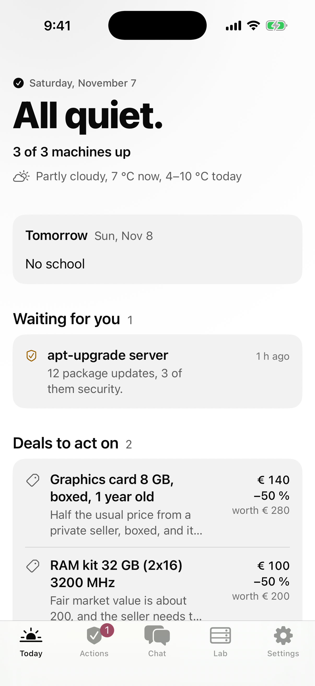
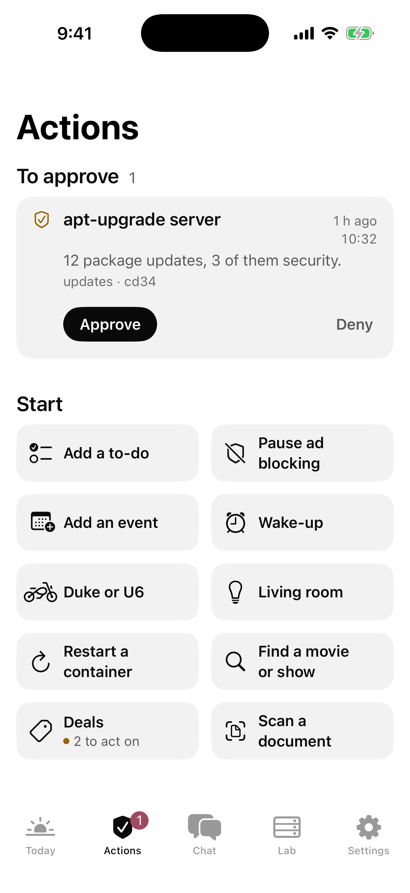
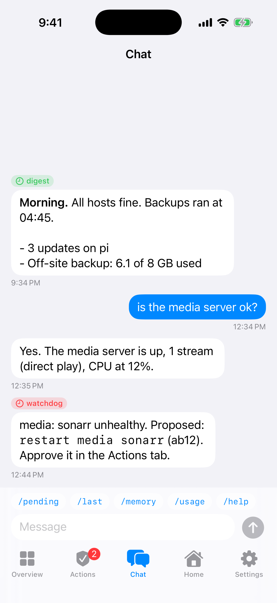
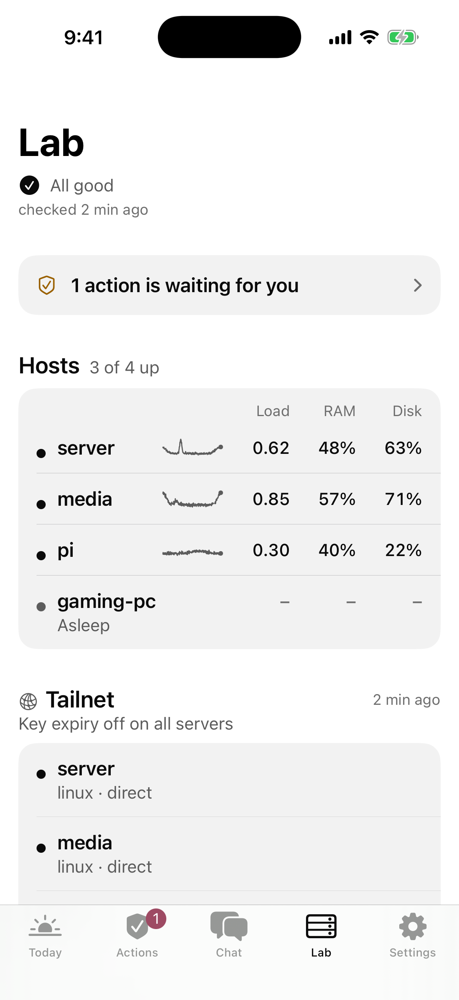
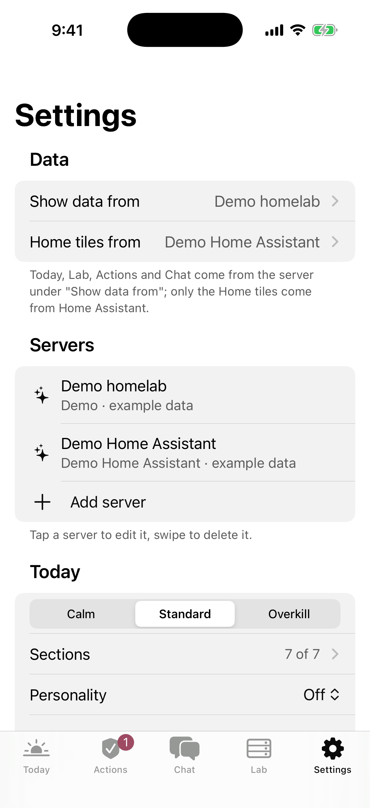
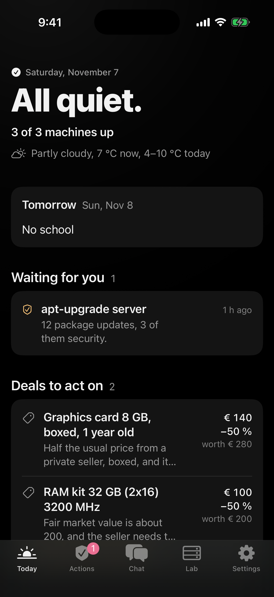

# Homelab iOS

A native iPhone app for a self-hosted homelab. It shows what is up, what needs attention and what waits for your
approval. It can chat with your homelab agent and switch Home Assistant devices. Open source, MIT, no account, no
cloud.

It is built with SwiftPM and [xtool](https://github.com/xtool-org/xtool), so you don't need a Mac or a paid Apple
developer account. You install it with [SideStore](https://sidestore.io) and a free Apple ID.

## What it does

| Tab | What you see and do |
|---|---|
| Today | Your day first: the server's "today" card in big numbers, actions waiting for you, your pinned Home Assistant tiles (tap to toggle or run), the other cards (media, downloads, school, …) and the last report. The machines are one status line that opens Lab. Pull to refresh; refreshes every 30 s while open |
| Actions | Actions your homelab proposes, with reason and age. Approve, Always or Deny, each with a confirm step. Shows the server's answer |
| Chat | Chat with your homelab agent. "Working…" while it runs, report tags (`morning`, `watchdog`, …), long-press to copy, quick buttons for the commands the server lists |
| Lab | Problems, a tile per host (load, RAM, worst disk, temperature, containers, flags), tap a host for details. A launcher for your web UIs (opens Safari) |
| Settings | Several servers, test connection, notifications, Face ID lock, demo mode, Diagnostics |

Tabs appear only when they make sense: Actions and Chat only if the server offers them. Home Assistant tiles appear on
Today when you add a Home Assistant server.

**Widgets** (read-only, from the last data the app fetched):

| Widget | Sizes | Shows |
|---|---|---|
| Homelab status | small, lock screen (circular, rectangular, inline) | Status, first problem, actions waiting |
| Homelab hosts | medium (4 hosts), large (8 hosts + problems) | Each host with load, RAM and disk |

Tapping a widget opens the right tab. Data older than 2 hours is dimmed and says how old it is. The status text is
hidden on the lock screen while the phone is locked.

## Who it is for

Anyone with a homelab and Tailscale (or another VPN) on the phone. You need one of these:

| You have | Use |
|---|---|
| Nothing special: a Linux box with some Docker apps | The [reference server](docs/REFERENCE_SERVER.md): one Python file, no dependencies |
| Home Assistant | Add it directly with a long-lived token (tiles on Today) |
| Your own agent or scripts | Implement the small JSON API in [`server/openapi.yaml`](server/openapi.yaml) |

You can combine them, for example the reference server plus Home Assistant. **Try the demo** on the first screen to
look around without any server.

## Screenshots

| Today | Actions | Chat |
|---|---|---|
|  |  |  |

| Lab | Settings | Dark mode |
|---|---|---|
|  |  |  |

## Install

> **Status (2026-11-04): no release yet.** The app is tested in CI and the simulator, not yet on a real iPhone.
> Until the first release, build and install it yourself: [docs/INSTALL-FROM-LINUX.md](docs/INSTALL-FROM-LINUX.md)
> (Linux) or [docs/SETUP.md](docs/SETUP.md) (macOS). Releases are built by hand, never by CI
> ([docs/RELEASE.md](docs/RELEASE.md)).

| Way | Good for | How |
|---|---|---|
| SideStore source | Most people. Updates show up in SideStore | In SideStore: Sources → + → `https://github.com/Qantrex/homelab-ios/releases/latest/download/source.json` (from the first release on) |
| IPA from GitHub Releases | One version, no source | Download `Homelab-<version>.ipa` from [Releases](https://github.com/Qantrex/homelab-ios/releases), then SideStore → My Apps → + |
| Build it yourself | Developers | xtool on Linux or macOS, see [docs/SETUP.md](docs/SETUP.md). From Linux straight to a phone over USB: [docs/INSTALL-FROM-LINUX.md](docs/INSTALL-FROM-LINUX.md) |

Details and troubleshooting: [docs/SIDESTORE.md](docs/SIDESTORE.md). Needs iOS 18 or newer.

## Quick start (a homelab with nothing yet)

On a Debian/Ubuntu server that is in your tailnet. Once per tailnet, in the Tailscale admin console → DNS: turn on
**MagicDNS** and **HTTPS Certificates** (`tailscale serve --https` needs both).

```bash
git clone https://github.com/Qantrex/homelab-ios && cd homelab-ios
printf '%s\n' '{"name": "homeserver", "trust_identity_header": "Tailscale-User-Login",' \
  ' "allowed_logins": ["you@example.com"], "this_host": {"kind": "server", "disks": ["/"]}}' > config.json
python3 server/reference_server.py --config config.json
```

Put your Tailscale login in `allowed_logins` (a refused login is printed in the log, so you can copy it). The full
example with hosts, checks and services is `server/config.example.json`.

In a second shell, publish it in your tailnet (pick a free port, `tailscale serve status` shows the used ones;
`tailscale serve` replaces what already runs on that port):

```bash
sudo tailscale serve --bg --https=7443 http://127.0.0.1:8791
```

On the iPhone, with Tailscale on: Homelab → **Add a server** → Type **Homelab API**, Address
`https://<machine>.<tailnet>.ts.net:7443`, Login **Tailscale / proxy** → **Test connection** → **Save**.

To run it for good (systemd), and for cards, actions and chat: [docs/SERVER-SETUP.md](docs/SERVER-SETUP.md).

## Limits

Honest list. Most come from the free Apple ID and from building without Xcode.

| Limit | Why |
|---|---|
| No Siri, no Shortcuts, no buttons in widgets, no Control Center | These need App Intents, and xtool can't build them yet |
| No Apple push notifications | APNs needs a paid developer account. The app can check in the background and send a local notification, but iOS decides when that runs (often every 15–60 minutes, sometimes much less) |
| Refresh every 7 days | Apps signed with a free Apple ID expire after 7 days. SideStore refreshes them over Wi-Fi; open SideStore now and then |
| 3 active apps | A free Apple ID allows 3 sideloaded apps, SideStore is one. The widget doesn't count, so Homelab uses one slot |
| One Home Assistant | The Home tab uses the first Home Assistant server you add |
| iPhone only, portrait | No iPad layout |

## Privacy

- The app talks only to the servers you add. No analytics, no crash reporting, no third-party code.
- Tokens are stored in the iOS Keychain on this phone only (not synced, not in backups to other devices). They are
  never written to files or logs and never given to the widget.
- Cached data (the last status per server) stays in the app's own storage so the widget and offline view can show it.
- Settings → Reset everything deletes all servers, tokens, cached data and settings.

More: [docs/SECURITY.md](docs/SECURITY.md).

## Docs

| Doc | For |
|---|---|
| [docs/SIDESTORE.md](docs/SIDESTORE.md) | Installing, the 7-day refresh, troubleshooting |
| [docs/SERVER-SETUP.md](docs/SERVER-SETUP.md) | Connecting a homelab: reference server, Home Assistant, your own server |
| [docs/REFERENCE_SERVER.md](docs/REFERENCE_SERVER.md) | All options of the reference server |
| [server/openapi.yaml](server/openapi.yaml) | The Homelab Companion API v1 |
| [docs/SECURITY.md](docs/SECURITY.md) | Threat model, what the app does, what server operators must do |
| [docs/SETUP.md](docs/SETUP.md) | Building with xtool, tests, project layout |
| [docs/CI.md](docs/CI.md) | CI and releases |
| [docs/INSTALL-FROM-LINUX.md](docs/INSTALL-FROM-LINUX.md) | Installing from a Linux PC over USB (no Mac) |
| [docs/API.md](docs/API.md) | The API in plain words, for writing your own server |
| [CONTRIBUTING.md](CONTRIBUTING.md) | Building, testing, code rules |
| [docs/RELEASE.md](docs/RELEASE.md) | Building and publishing a release by hand |
| [CHANGELOG.md](CHANGELOG.md) | What changed |

## License

MIT, see [LICENSE](LICENSE).
