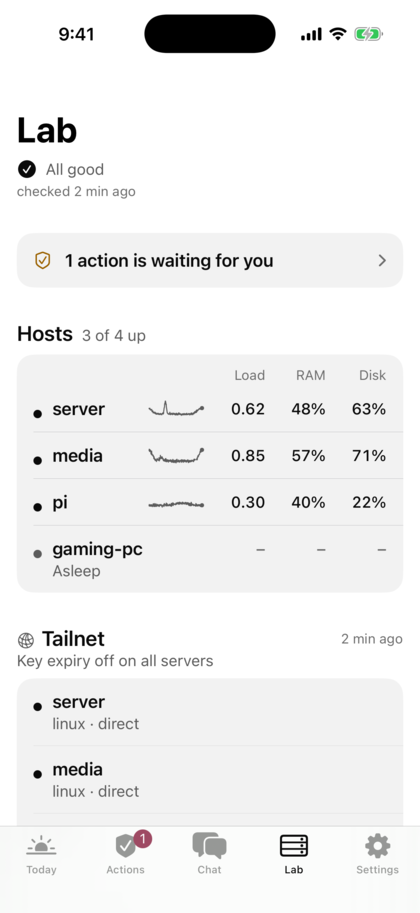

# Getting started

From nothing to a working app, on your own homelab. You need no AI agent and no paid Apple account. The examples use
the made-up tailnet `tail1234.ts.net`; use yours.

## 1. Pick a setup

| You run | Setup | Today then shows |
|---|---|---|
| Home Assistant, nothing else you want to see | [A. Only Home Assistant](#a-only-home-assistant) | "Home." with what is on and what doesn't answer, and your Home tiles. No Lab, no widgets with data |
| Services like Uptime Kuma, Gatus, Docker or Proxmox | [B. Homelab Bridge](#b-homelab-bridge) | "All quiet." or "1 problem.", problems from your services, Lab with your machines and cards, widgets |
| Your own agent or scripts | [C. Your own server](#c-your-own-server) | What your server sends: from a status line up to actions and chat |

You can combine B or C with A: the app shows one Homelab server ("Show data from") and one Home Assistant ("Home
tiles from") at a time.

Not sure? Install the app and tap **Try the demo** on the first screen. It needs no server.

## 2. What you need

- An iPhone with iOS 18 or newer.
- [Tailscale](https://tailscale.com) on the phone and on the server (another VPN to your home works too; the steps
  here use Tailscale). In the Tailscale admin console → DNS, turn on **MagicDNS** and **HTTPS Certificates** once.
- A free Apple ID and one way to install:

| You have | Guide |
|---|---|
| A Linux PC and a USB cable | [INSTALL-FROM-LINUX.md](INSTALL-FROM-LINUX.md) |
| A Mac | [SETUP.md](SETUP.md) (the same xtool steps) |
| SideStore on the phone | [SIDESTORE.md](SIDESTORE.md): until the first release you still need one Linux PC or Mac once, to build the IPA (`scripts/build-ipa`, [SETUP.md](SETUP.md)) that you then import in SideStore. After the first release SideStore needs no computer for Homelab |

Until the first release you build the app yourself (see [Install](../README.md#install); the first build takes a few minutes).

## A. Only Home Assistant

1. Make Home Assistant reachable over HTTPS in your tailnet. The app never sends a token over plain `http://`. On
   the machine that runs HA, with Tailscale on it:

   ```bash
   sudo tailscale serve --bg --https=8443 http://127.0.0.1:8123
   ```

   HA then sees requests from a proxy. Tell it to trust it, in `configuration.yaml`, and restart HA:

   ```yaml
   http:
     use_x_forwarded_for: true
     trusted_proxies:
       - 127.0.0.1
       - ::1
   ```

   Home Assistant OS: the Tailscale add-on can serve HA over HTTPS too (see the add-on's docs), or use HA's own TLS.
2. In HA: your profile → Security → **Long-lived access tokens** → Create token. Copy it; HA shows it only once. A
   separate HA user for the phone makes it easy to revoke.
3. In the app: **Add Home Assistant** (a button on the welcome screen, which only shows on the first start; later: Settings → Add server → Type **Home Assistant**) → Address `https://ha.tail1234.ts.net:8443` → paste the token → **Save**.
4. "Found" lists your devices in words ("12 lights, 4 switches and 3 scenes"). **Home** is checked → **Start**.
5. The tile picker opens: tap the lights, scenes or scripts you use most → **Done**.

What you see: Today's headline is "Home." with what is true under it ("1 light on", "Front door open"). A device that
doesn't answer shows in gold ("Bedroom fan unavailable"). Your tiles are below; a tap switches them. The tabs are
Today and Settings. CI takes this as shot 29, `demo-ha-only` ([CI.md → Screenshots](CI.md#screenshots)).

Limits of this setup: no Lab, and the widgets stay empty (they read a Homelab server). For those, add B.

## B. Homelab Bridge

The Homelab Bridge is the [reference server](REFERENCE_SERVER.md) from this repo with `sources`: it reads the APIs of
your services and shows what they report. It runs in Docker next to a Tailscale sidecar, which is its own machine in
your tailnet (`homelab-bridge`). No port opens on your Docker host.

| Service | Source type | State |
|---|---|---|
| Uptime Kuma (a status page) | `uptime-kuma` | Works |
| Gatus | `gatus` | Works |
| Anything that answers JSON in the shape of `/state` | `json` | Works |
| Docker (through a socket proxy) | `docker` | Works |
| Proxmox VE (an API token, read-only) | `proxmox` | Works |
| Pi-hole v6 (an app password) | `pihole` | Works |
| AdGuard Home | `adguard` | Works |
| Sonarr, Radarr (the API key) | `sonarr`, `radarr` | Works |
| qBittorrent (an API key, or a WebUI login) | `qbittorrent` | Works |
| Game servers (Minecraft Java, Valheim, Palworld, CS2, ...) | `gameserver` | Works: status ping only, never wakes a sleeping server |
| A Homepage `services.yaml` | the `homepage` key ([import](SERVER-SETUP.md#import-from-homepage)) | Works: its services in the launcher, its Kuma, Gatus, Proxmox, Pi-hole (v6), AdGuard, Sonarr, Radarr and qBittorrent widgets as sources |

Details per source: [SERVER-SETUP.md → Sources](SERVER-SETUP.md#sources). For Docker, `docker compose --profile docker
up -d` also starts the socket proxy ([REFERENCE_SERVER.md → Docker](REFERENCE_SERVER.md#docker)). Without Docker,
the same server runs as one Python file with systemd ([SERVER-SETUP.md → the 5-minute path](SERVER-SETUP.md#the-5-minute-path-debian-or-ubuntu-behind-tailscale-serve)).

You need Docker with Compose 2.17 or newer on Linux.

1. Get the files and make your copies (they stay out of git):

   ```bash
   git clone https://github.com/Qantrex/homelab-ios
   cd homelab-ios/server
   cp docker/config.example.json docker/config.json
   cp docker/bridge.env.example docker/bridge.env
   cp docker/tailscale.env.example docker/tailscale.env
   chmod 600 docker/bridge.env docker/tailscale.env
   ```

2. In `docker/config.json`: put your Tailscale login in `allowed_logins` (the e-mail, or `name@github`), and your
   services in `sources`. Use the LAN address of a service, not `127.0.0.1` (that is the container):

   ```json
   "sources": [
     {"name": "Kuma", "type": "uptime-kuma", "url": "http://192.0.2.10:3001", "slug": "home"},
     {"name": "Gatus", "type": "gatus", "url": "http://192.0.2.10:8080"}
   ]
   ```

   A source that needs a key names an env variable (`"key_env": "KUMA_KEY"`); the key goes in `docker/bridge.env`.
3. In the Tailscale admin console: Settings → Keys → **Generate auth key** (not reusable, not ephemeral). Put it in
   `docker/tailscale.env` as `TS_AUTHKEY=...`.
4. Start it and check it:

   ```bash
   docker compose up -d --build     # builds the image from this checkout (add `--profile docker` if you use the `docker` source)
   docker compose ps                # both "healthy" after a minute
   curl https://homelab-bridge.tail1234.ts.net/api/v1/info   # from another tailnet device, with your login
   ```

   `{"api": 1, "name": "Homelab Bridge", ...}` means it works. A 403 means your login is not in `allowed_logins`
   (`docker compose logs bridge` shows the refused one). A 401 means the request didn't come through the bridge's
   `tailscale serve` address (`https://homelab-bridge.…`): use that address, not an IP or a port. Right after the start
   a 401 can also mean the sidecar isn't up yet: wait until both are `healthy` and try again. If `docker compose
   ps` never shows `healthy` and the machine doesn't appear in your tailnet, `docker compose logs tailscale` shows an
   expired or already used auth key: generate a new one (step 3), put it in `docker/tailscale.env` and run
   `docker compose up -d` again. If `bridge` keeps restarting in `docker compose ps` and `docker compose logs bridge`
   says `ERROR: no tailscale0 interface in this network namespace 60 s after the start`, the Tailscale sidecar
   isn't up with kernel networking: check `docker compose logs tailscale`, and that the host has `/dev/net/tun` (some
   LXC and NAS setups lack it). Details: [SERVER-SETUP.md](SERVER-SETUP.md#docker).
5. In the app: **Add a Homelab server** (welcome screen: Add a Homelab server; later: Settings → Add server) → Type **Homelab API** → Address `https://homelab-bridge.tail1234.ts.net` → Login **Tailscale /
   proxy** → **Save**. "Found" lists what it offers; **Watch** is checked → **Start**.

   The app calls this kind of server "Homelab API".

What you see: Today says "All quiet." or "1 problem."; a down monitor is a problem ("Jellyfin: down"). Lab
shows the bridge as a machine, Proxmox nodes with a 24 h history, a card per monitor source ("11 of 12 up") and
monitors with a public link in the launcher. Settings → Advanced → Diagnostics lists each source as ok or failing. The status and
hosts widgets work, also with the app closed. Actions and Chat stay hidden: they are off on the bridge. Screenshots of
Lab from the demo (it has more than a new bridge):

{: width="280"}

More: other machines (`hosts`), web checks, cards from your own scripts, the socket proxy for containers, updates:
[SERVER-SETUP.md → Docker](SERVER-SETUP.md#docker) and [REFERENCE_SERVER.md](REFERENCE_SERVER.md). **Never use
Tailscale Funnel** for the bridge: it puts it on the public internet.

## C. Your own server

Anything that answers two JSON endpoints works: `GET /api/v1/info` and `GET /api/v1/state`. Add more endpoints when
you want actions, chat or a launcher.

1. Read [API.md](API.md) (the API in plain words) or [`server/openapi.yaml`](../server/openapi.yaml) (the contract).
   [SERVER-SETUP.md → Your own server](SERVER-SETUP.md#c-your-own-server) has a short Python server to start from.
2. Listen on `127.0.0.1` only and put `tailscale serve` in front (it adds HTTPS and your login), or check a bearer
   token.
3. Check it with the same test the owner's server passes (read-only, bash and python3):

   ```bash
   scripts/check-live-api https://nas.tail1234.ts.net:7444
   ```

4. In the app: **Add a Homelab server** (first start only; later Settings → Add server → Type **Homelab API**) → your address → Login **Tailscale / proxy** or **Token** → **Save**.

What you see depends on `features` in `/info`: `status` and `hosts` give Today and Lab; `actions` adds the Actions
tab, `chat` the Chat tab, `cards` the cards. A feature you leave out is a tab or section the app doesn't show. To
change the app itself: [ADAPTING.md](ADAPTING.md).

## How long Today is

Today is short by design. Settings → Today → **Detail** (a menu like Personality; the lines under it say what each shows) picks how much it shows, for the default text size:

- **Minimal**: one screen, your day and the Home tiles; Lab is compact too (the problems, one line per host, cards and services folded to a title and a count).
- **Standard** (the default): two screens at most. The hero, tomorrow, the actions to approve (2, then "and N more")
  and every row that needs you come first: a deadline that is overdue or within 3 days (later deadlines are always behind "Show N more"), a delay, a
  to-do past its time. Longer lists show 3 rows and a "Show N more" row. Deals, recent downloads, new grades and news
  are small tiles with a count and one line ("best −50 %", "Dune +7", "ITP 95 %"); tap one to open the full list in a
  sheet. Departures appear in the day card, at the top, only while your "Leave by" is within the hour.
- **Detailed**: the same sections as Standard, three screens at most, with more detail in every line (the deals tile says "best −70 % · GPU €140") and a few more rows before a fold.
- **Hyperdetail**: everything, unfolded, in the whole app: no list is folded, every field the server sent is shown (ids, exact times, units, a host's whole history), and with a personality on, a remark on every fact. It asks once before it switches on, and it is not recommended.

What you open folds again the next time you start the app. The machines are not on Today: open Lab for them.

## The weather line and the lessons

If your server sends a card with the id `weather`, its subtitle shows as one grey line under the headline's facts ("Clear, 7 °C now, 4–10 °C today"), in every detail level, Minimal too; the card itself is not drawn on Today. A subtitle without a temperature gets the current one added. A lessons card (a school timetable) shows a cancelled lesson struck through and grey, and a substitution or room change with a gold dot and a gold time; VoiceOver says "cancelled" or "changed".

## Show rules

Every section of Today can have a rule for when it shows. Settings → Advanced → **Sections**: each row says its rule in
words ("Always", "Evenings", "Not on your servers"); tap it and choose when it shows:

- **Always**, or **When it needs me** (it appears as soon as it has something for you).
- A time: **Mornings**, **Daytime**, **Evenings**, **Weekdays** or **Weekends**, or **Custom** with From, To and the
  days. A time that ends before it starts runs past midnight.
- **At home** or **Away**, once **Where you are** is set (Settings → Advanced → Where you are). It follows one person or
  device tracker in Home Assistant, so it needs a Home Assistant server. Homelab asks for no location. When Home
  Assistant hasn't answered for 30 minutes, both rules show their sections.

Done saves, Cancel keeps the old rule. The switch on the row still hides a section for good. While a rule hides
something that has content, Today ends with "Hidden now: Deals and Cards (evenings) · Show". Tap **Show** to let those
sections through until you close the app; the rule stays.

Related: Settings → Advanced → **Quiet hours** mutes the app's own notifications in a time window (from, to).
It doesn't hide anything on Today.

## Customize

Settings is short on purpose. **Settings → Advanced** (called Nerd section with a snarky personality) holds the rest:

- **Sections**: Today's order, hide and show rules (see above), and **Where you are**.
- **Start tiles**, **Lab** and **Tab bar**: switch an item off to hide it, drag the handles to reorder. Start tiles are
  your server's actions (by name); Lab has Hosts, your server's cards and Services (Problems always stay on top); the
  tab bar never hides Settings. What your server adds later shows up at the end. A link to a hidden tab shows an alert
  saying it is hidden.
- **Chat**: **Text size** (Small, Default, Large; one step from the iPhone's size) and **Long replies** (Short folds
  after 6 lines, Default 12, Never fold).
- **Today → News** (only when your server has news): On or Off, your country, which sources (yours plus tech and
  international ones), summaries or headlines, 3, 5 or 8 stories and the last 12, 24 or 48 hours. The choices are saved
  on your server, which fetches the feeds; the News tile on Today opens a sheet and each story opens in reader mode.
- Quiet hours, Leave-by on the lock screen, Diagnostics and Demo servers.

## Limits

| Limit | Why, and what to do |
|---|---|
| The app stops opening after 7 days | A free Apple ID signs for 7 days. Today warns 2 days before. Install again over USB (your data stays), or let SideStore refresh it |
| 3 sideloaded apps, 10 new App IDs a week | Free Apple ID. Homelab is one app; each install uses 3 App IDs (app, widget, share extension) |
| No push notifications, no Siri actions | They need a paid account or App Intents (the Actions widget uses them; see DESIGN.md). The app checks in the background when iOS lets it and sends a local notification |
| Tailscale must be on | The app reaches your servers only through your tailnet (or VPN). After a SideStore refresh, check that Tailscale is on again |
| Tokens only over HTTPS | A Home Assistant or token server at `http://` gets nothing. `tailscale serve` gives HTTPS with a real certificate |
| Tagged Tailscale devices | They get no login header. Use a token (`HOMELAB_TOKENS`) and Login **Token** |
| One Homelab server and one Home Assistant at a time | Settings → "Show data from" and "Home tiles from" pick them. The bridge merges your services into one |

## Troubleshooting

| You see | Fix |
|---|---|
| "Can't reach `<host>`. Is Tailscale (or your VPN) on?" | Turn Tailscale on. On the server: `tailscale serve status`, and the `curl` above from another tailnet device |
| "The server refused access. …" (403) | Your login is not in `allowed_logins`. The server log shows the refused login |
| "No login reached the server. …" (401) | The request didn't come through `tailscale serve` (or the phone isn't logged in, or it is a tagged device), or the Token is wrong. Right after a bridge start: its Tailscale sidecar isn't up yet, try again in a minute |
| `bridge` keeps restarting; its log says "ERROR: no tailscale0 interface in this network namespace 60 s after the start" | The Tailscale sidecar isn't up with kernel networking. `docker compose logs tailscale`, and check the host has `/dev/net/tun` (missing in some LXC and NAS setups). See [SERVER-SETUP.md](SERVER-SETUP.md#docker) |
| "Home Assistant refused the token. …" | Create a new long-lived token (HA profile → Security) and paste it under Edit server |
| "Can't find `<host>`. Check the address." | Typo in the address, or the name isn't known (MagicDNS off for a `.ts.net` name). Check it in the Tailscale app |
| "The server answered with a redirect (HTTP 301). Enter the final address: often https:// or another port." | Enter the address the redirect leads to, often `https://` instead of `http://`, or the other port |
| "The secure connection failed (certificate?)." | Self-signed or expired certificate. Use `tailscale serve` (real certificates) |
| "Too many requests. Try again in a minute." | The server limits requests. Wait a minute |
| Home Assistant: "The server rejected the request." (400) | HA doesn't trust the proxy: `use_x_forwarded_for` and `trusted_proxies` as in A, step 1 |
| "This server uses a token over plain http. …" | Use the `https://….ts.net` address from `tailscale serve` |
| "The server's answer couldn't be read. …" | The address points at a web page. Use the base address; the app adds `/api/v1` |
| A source shows as one warning, for example "Kuma: 401" | Its key, URL or slug is wrong, or the service is down. Settings → Advanced → Diagnostics → Sources and `docker compose logs bridge` say which |
| The Actions widget is empty or does nothing | Add it (long-press the Home screen, +, Homelab, Actions), long-press it, Edit Widget, pick actions (none picked = your first Start tiles). Open the app once so it has the list. A tap runs only actions without fields on a Tailscale server; the others open the app |
| The widgets stay empty | Open the app once. With only Home Assistant they have nothing to show (see A) |
| The app doesn't open | It expired after 7 days: install it again |

SideStore and widget problems, and every message with more detail: [SIDESTORE.md → Troubleshooting](SIDESTORE.md#troubleshooting). In the
app, Settings → Advanced → Diagnostics → **Copy report** gives a report without tokens to paste into an issue.
