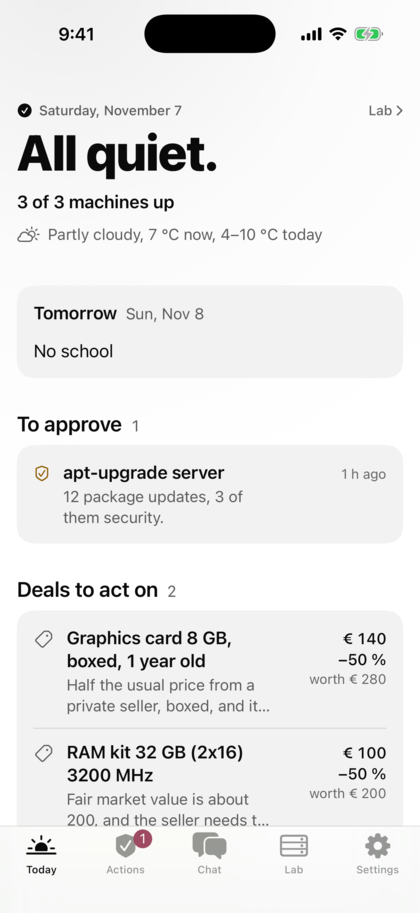

# Homelab iOS

A native iPhone app for a self-hosted homelab: what is up, what needs attention and what waits for your approval,
plus a chat with your homelab agent and your Home Assistant devices. It is built with SwiftPM and xtool and installed
with a free Apple ID, from Linux or a Mac, or with SideStore. Source available, free for noncommercial use
(PolyForm Noncommercial), no account, no cloud.

The [README on GitHub](../README.md) has the screenshots, the quick start and the limits.

{: width="280"}

> **Is this for me? What you need**
>
> - An iPhone with iOS 18 or newer and a free Apple ID.
> - A **Linux or Mac computer to build the app once**. There is no download yet: the owner publishes a release only
>   when he calls it 1.0.0, and no date is promised. Building takes a couple of hours the first time (an Xcode download
>   of about 2 GB, see [Install from Linux](INSTALL-FROM-LINUX.md)).
> - **Windows only: not yet.** Building needs Linux or macOS; xtool describes WSL for Windows, which is untested here.
> - [Tailscale](TAILSCALE.md) or another HTTPS route to your servers (free for personal use; the page explains it).
> - Re-signing every 7 days (a free Apple ID's limit). SideStore does it by itself; with a USB install you plug in again.
> - Just curious? After the install the app has a demo that needs no server.

The three setups, each in one line:

- **Only Home Assistant:** your lights, scenes and scripts as tiles.
- **Homelab Bridge:** a Docker container next to your services (Kuma, Pi-hole, Proxmox, *arr, ...) that the app reads.
- **Your own server:** anything that speaks the small [API](API.md).

**New here?** [Getting started](GETTING-STARTED.md): pick one of three setups (only Home Assistant, the Homelab Bridge
with your services, or your own server), install the app, connect it, and fix what goes wrong.

## Docs

- [Getting started](GETTING-STARTED.md): from nothing to a working app, three setups, limits, troubleshooting
- [Features](FEATURES.md): every feature, where it lives, its tests, phone checks, docs and dependencies
- [Setup](SETUP.md): building with xtool, tests, project layout
- [Tailscale and HTTPS](TAILSCALE.md): what it is, the Home Assistant OS add-on, Nabu Casa and other routes
- [Install from Linux](INSTALL-FROM-LINUX.md): build and install onto an iPhone over USB, no Mac (Arch, Debian/Ubuntu, Fedora)
- [SideStore](SIDESTORE.md): installing and the 7-day refresh, the -80045 fix
- [Server setup](SERVER-SETUP.md): connecting a homelab (reference server and Homelab Bridge, Home Assistant, your own server)
- [API](API.md): the Companion API in plain words, for writing your own server
- [Adapting](ADAPTING.md): fork it for your homelab, turn modules off, add your own
- [Security](SECURITY.md): threat model, what the app does, what server operators must do
- [Design](DESIGN.md): how every screen and widget looks
- [Release](RELEASE.md): building and publishing a release by hand
- [Shortcuts](SHORTCUTS.md): `homelab://` links, Shortcuts recipes, quick actions

License: PolyForm Noncommercial 1.0.0, free for noncommercial use; commercial use needs a license from the author ([README](../README.md)).

Also: [Reference server](REFERENCE_SERVER.md) options, [Homelab Bridge sources](BRIDGE.md), [CI](CI.md), the [changelog](../CHANGELOG.md) and the
[phone checks](../DeviceTest.md).
